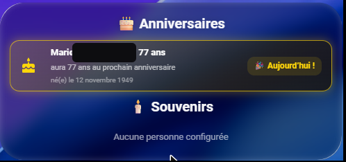
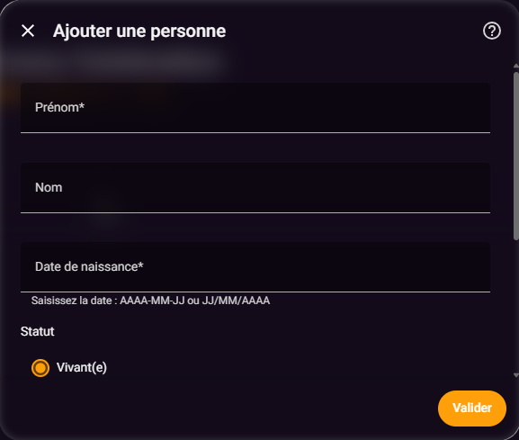
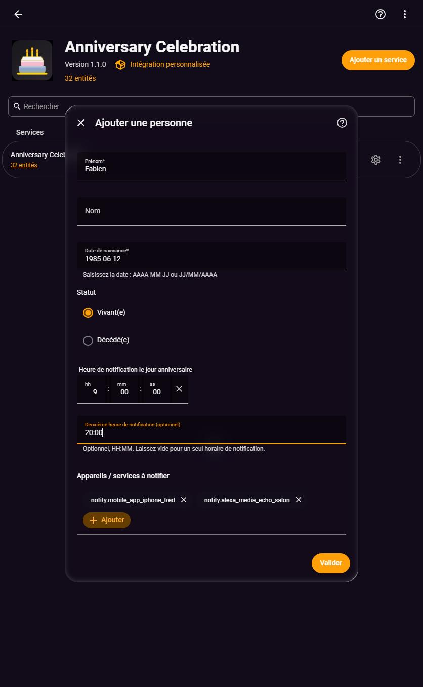
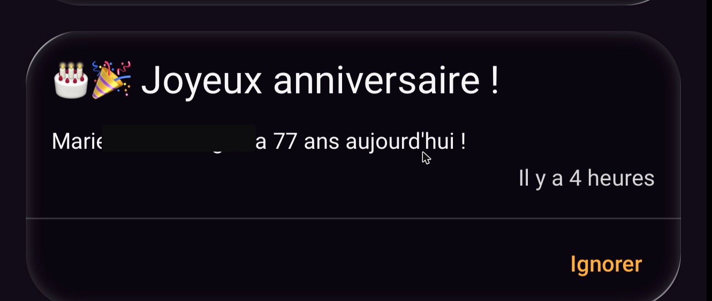
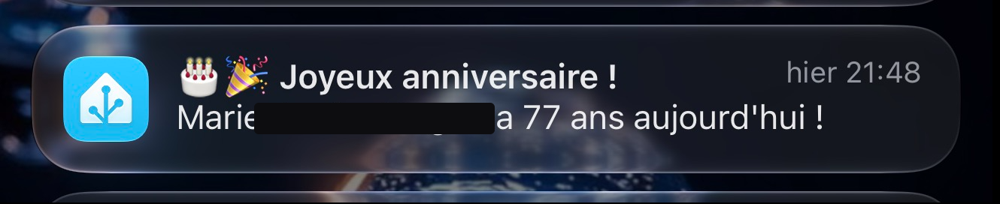
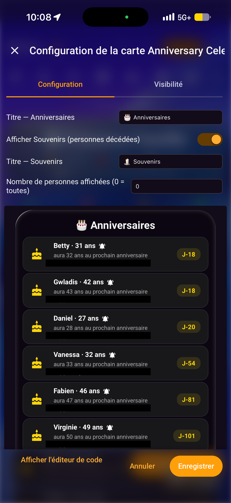

# 🎂 Anniversary Celebration

🇫🇷 [Version française](README.md)

[](https://github.com/hacs/integration)
[](https://github.com/cyclope205/anniversary-celebration/releases)
[](https://github.com/cyclope205/anniversary-celebration/actions/workflows/validate.yml)
[](https://github.com/cyclope205/anniversary-celebration/actions/workflows/tests.yml)
[](https://github.com/cyclope205/anniversary-celebration/issues)
[](https://github.com/cyclope205/anniversary-celebration/blob/main/LICENSE)
[](https://github.com/cyclope205/anniversary-celebration/releases)
[](https://github.com/cyclope205/anniversary-celebration/releases/latest)
[](https://github.com/cyclope205/anniversary-celebration/stargazers)
[](https://github.com/cyclope205/anniversary-celebration/network/members)

---

### ❤️ GitHub Sponsors

<!--START_SECTION:github-sponsors-->
<!-- No active public GitHub sponsor at the moment -->
<!--END_SECTION:github-sponsors-->

---
### ☕ Thanks to our supporters

<!--START_SECTION:paypal-->

<!--END_SECTION:paypal-->

<!--START_SECTION:buy-me-a-coffee-->
<!-- New donations will be added here automatically -->
<!--END_SECTION:buy-me-a-coffee-->

---

[](https://bmc-eight-red.vercel.app/api/donate?repo=anniversary-celebration) [](https://bmc-eight-red.vercel.app/api/paypal?repo=anniversary-celebration&amount=5)


### ☕ Buy me a coffee to help me stay awake and keep building your favorite integrations!

As a thank you, your name will appear (anonymized) in the "☕ Thanks to our supporters" section above.

---

Home Assistant integration that tracks the birthdays of living people and keeps the memory of those who have passed away, with a reliable notification on the day and a Lovelace card that builds itself.

## Table of contents

- [Features](#features)
- [Screenshots](#screenshots)
- [Installation](#installation-hacs)
- [Configuration](#configuration)
- [Card — configuration](#card--configuration)
- [Notification reliability](#notification-reliability)
- [Available languages](#available-languages)
- [Tests](#tests)
- [Good to know](#good-to-know)

## Features

- Add/edit/remove people through the UI (Settings →
Devices & services → Anniversary Celebration → Configure): first name, last name,
date of birth, status (alive / deceased), up to two notification times
(optional), one or more devices/services to notify (optional).
- One sensor per person (`sensor.<first_name>_<last_name>`): number of days until the
next birthday, current age, age at the next birthday, date of
birth, status, and whether today's notification has already been sent.
- Deceased people can also be notified (a different "in
memory" message instead of the living one).
- `anniversary-celebration-card` card: builds itself automatically from
the configured people (no need to touch the dashboard YAML on every
addition), sorted by proximity, with a 🔔 next to the name
when a reminder device/service is configured for that person.
The number of people displayed is freely configurable
(`max_items`), and a visual editor lets you show or hide the
Memories section without writing any YAML.

## Screenshots

Birthdays / Memories card:



Add-a-person form (integration options):



Choosing the notification times and the devices/services to notify (further down the same form):



Notification on the day (persistent in Home Assistant and on mobile):





Card editor with live preview (birth dates blurred out in this screenshot):



## Installation (HACS)

1. Open Anniversary Celebration in HACS and install it:
2. [](https://my.home-assistant.io/redirect/hacs_repository/?owner=cyclope205&repository=anniversary-celebration&category=integration)
3. [](https://my.home-assistant.io/redirect/marketplace_repository/?owner=cyclope205&repository=anniversary-celebration&category=integration)
4. or search for **Anniversary Celebration** in HACS if the repository is already listed.
5. Restart Home Assistant.
6. Add the integration:
7. [](https://my.home-assistant.io/redirect/config_flow_start/?domain=anniversary_celebration)
8. or **Settings → Devices & services → Add integration → Anniversary Celebration**.
9. Configure it to add your first people.

10. The Lovelace card is registered automatically by the integration: no resource to declare by hand.

## Configuration

From the integration's options (**Settings → Devices & services →
Anniversary Celebration → Configure**), a menu lets you add, edit,
or remove a person. Each person has:

| Field | Required | Description |
|---|---|---|
| First name | Yes | First name shown on the card and in notifications |
| Last name | No | Last name, optional |
| Date of birth | Yes | Used to calculate age and the countdown |
| Status | Yes | Alive or Deceased — changes the notification message |
| Notification times | No | Up to two times on the day (default 09:00). Duplicate times are rejected/deduplicated. |
| Devices/services to notify | No | One or more `notify.*` services; if left empty, only the Home Assistant persistent notification is created |

## Card — configuration

```yaml
type: custom:anniversary-celebration-card
title_alive: "🎂 Birthdays"
title_deceased: "🕯️ Memories"
show_deceased: true
max_items: 0 # 0 or absent = everyone; otherwise any number
```

## Notification reliability

There is no single timer scheduled months in advance (which could be lost on a
Home Assistant restart, even if the birthday is 8 months away).
The integration recalculates each person's state **every minute**.
When the anniversary day and one of the configured times are reached, each
time slot is handled independently. Success is tracked separately for every
`notify.*` service: a failed target is retried without resending to targets
that already succeeded. A Home Assistant persistent notification is also
created, and the delivery state is saved to persistent storage so it survives
Home Assistant restarts.

## Available languages

The configuration UI (adding/editing/removing a person,
options menus) is translated into 22 of the languages most used by
Home Assistant: French, English, German, Spanish, Italian, Portuguese
(Portugal and Brazil), Dutch, Polish, Russian, Swedish, Norwegian,
Danish, Finnish, Czech, Slovak, Hungarian, Turkish, Greek, Romanian,
Ukrainian, and Catalan. Home Assistant automatically picks the translation
matching the language set in your user profile; if there is no
match, English is used.

## Tests

The repository includes an automated test suite (`tests/`, based on
`pytest`) covering in particular date calculations (days remaining, current
age, age at the next birthday, the day-of and February 29th cases) and
the duplicate/missed-notification prevention logic. Tests run
automatically on every change via GitHub Actions (the "Tests" badge
above).

## Good to know

- The check runs every minute: a notification scheduled for
a given time may fire up to ~59 seconds after it, never
before.
- "Deceased" status does not prevent the notification: only the message
changes ("in memory" instead of "happy birthday").
- Bugs and feature requests are reported via the repository's
**Issues** tab.

## License

MIT — see [LICENSE](https://github.com/cyclope205/anniversary-celebration/blob/main/LICENSE).
