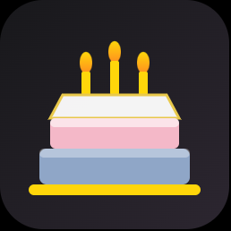
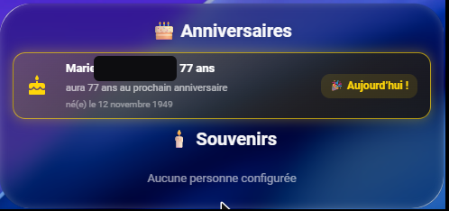
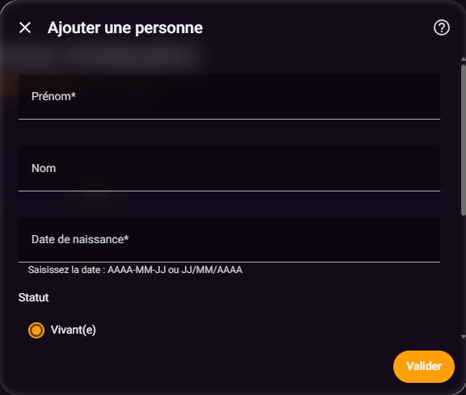
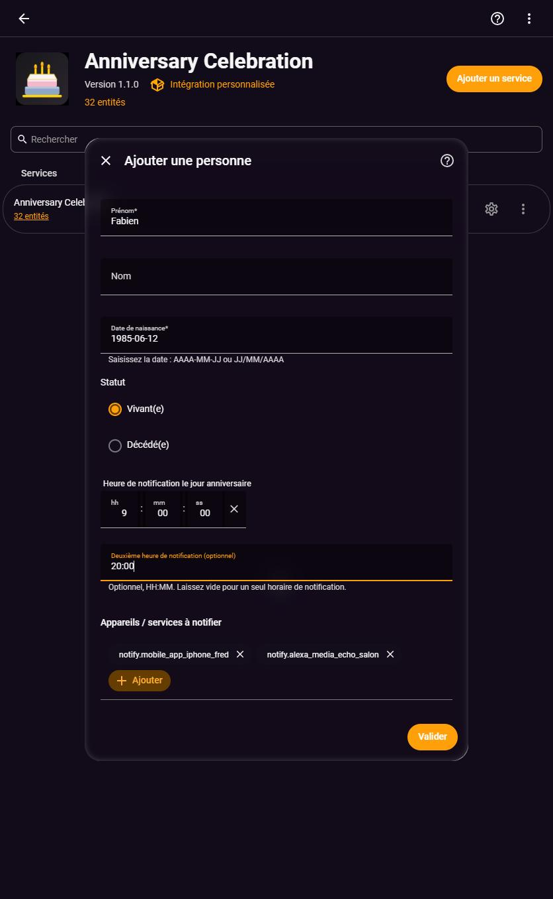
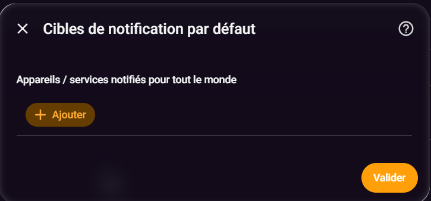
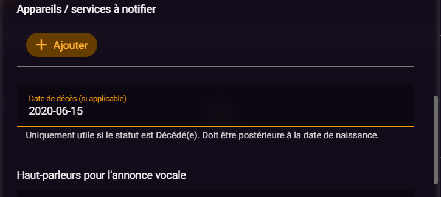
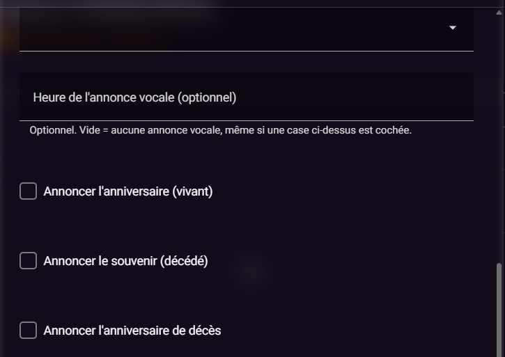
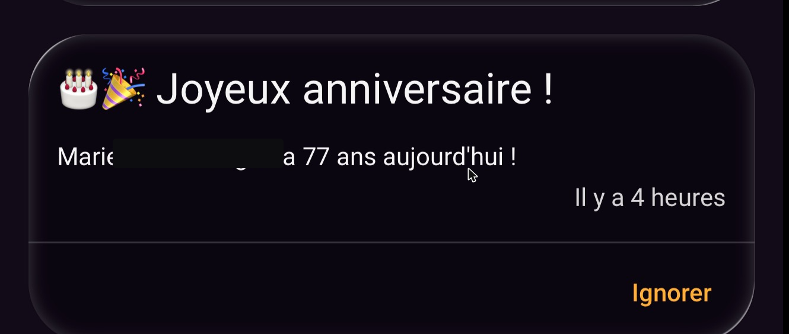
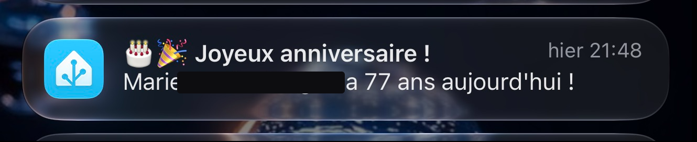
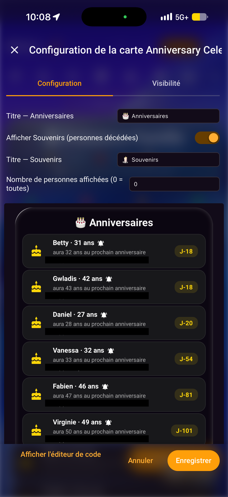

# 🎂 Anniversary Celebration

🇬🇧 [English version](README.en.md)

[](https://github.com/hacs/integration)
[](https://github.com/cyclope205/anniversary-celebration/releases)
[](https://github.com/cyclope205/anniversary-celebration/actions/workflows/validate.yml)
[](https://github.com/cyclope205/anniversary-celebration/actions/workflows/tests.yml)
[](https://github.com/cyclope205/anniversary-celebration/issues)
[](https://github.com/cyclope205/anniversary-celebration/blob/main/LICENSE)
[](https://github.com/cyclope205/anniversary-celebration/releases)
[](https://github.com/cyclope205/anniversary-celebration/releases/latest)
[](https://github.com/cyclope205/anniversary-celebration/stargazers)
[](https://github.com/cyclope205/anniversary-celebration/network/members)

---

### ❤️ Sponsors GitHub

<!--START_SECTION:github-sponsors-->
<!-- Aucun sponsor GitHub public actif pour le moment -->
<!--END_SECTION:github-sponsors-->

---
### ☕ Merci aux donateurs

<!--START_SECTION:paypal-->

<!--END_SECTION:paypal-->

<!--START_SECTION:buy-me-a-coffee-->
<!-- Les nouveaux dons seront ajoutés ici automatiquement -->
<!--END_SECTION:buy-me-a-coffee-->

---

[](https://bmc-eight-red.vercel.app/api/donate?repo=anniversary-celebration) [](https://bmc-eight-red.vercel.app/api/paypal?repo=anniversary-celebration&amount=5)


### ☕ Offrez-moi un café pour m'aider à rester éveillé et coder vos intégrations préférées !

En remerciement, votre nom apparaîtra (de façon anonymisée) dans la section « ☕ Merci aux donateurs » ci-dessus.

---

Intégration Home Assistant qui suit les anniversaires des personnes vivantes et garde le souvenir des personnes décédées, avec une notification fiable le jour J et une carte Lovelace qui se construit toute seule.

## Sommaire

- [Fonctionnalités](#fonctionnalités)
- [Captures d'écran](#captures-décran)
- [Installation](#installation-hacs)
- [Configuration](#configuration)
- [Carte — configuration](#carte--configuration)
- [Fiabilité des notifications](#fiabilité-des-notifications)
- [Langues disponibles](#langues-disponibles)
- [Tests](#tests)
- [A savoir](#a-savoir)

## Fonctionnalités

- Ajout/modification/suppression des personnes via l'interface (Paramètres →
  Appareils et services → Anniversary Celebration → Configurer) : prénom, nom,
  date de naissance, statut (vivant / décédé), jusqu'à deux horaires de
  notification (optionnels), un ou plusieurs appareils/services à notifier
  (optionnel).
- Un capteur par personne (`sensor.<prénom>_<nom>`) : nombre de jours avant le
  prochain anniversaire, âge actuel, âge au prochain anniversaire, date de
  naissance, statut, et si la notification du jour a déjà été envoyée. Une
  personne de moins d'1 an affiche son âge en mois (ex. « 4 mois ») plutôt
  que « 0 ans », et l'accord singulier « 1 an » est respecté partout où un
  âge en années est affiché ou annoncé.
- Les personnes décédées peuvent aussi être notifiées (message « en
  mémoire » différent de celui des vivants).
- Rappel indépendant pour l'anniversaire de décès (si une date de décès est
  renseignée) : déclencheur séparé de l'anniversaire de naissance, avec son
  propre suivi anti-doublon.
- Cibles de notification par défaut, au niveau de l'intégration (menu des
  options), ajoutées automatiquement à celles de chaque personne — pratique
  pour notifier un appareil commun sans le configurer sur chaque fiche.
- Annonce vocale optionnelle (texte-à-parole), entièrement indépendante des
  notifications écrites ci-dessus : ses propres haut-parleurs, son propre
  moteur TTS, son propre horaire, un volume optionnel (appliqué avant
  l'annonce puis restauré automatiquement après), et trois cases à cocher
  séparées (anniversaire, souvenir, anniversaire de décès), toutes
  désactivées par défaut.
- Carte `anniversary-celebration-card` : se construit automatiquement à
  partir des personnes configurées (pas besoin de toucher le YAML du
  dashboard à chaque ajout), triée par proximité, avec un 🔔 à côté du nom
  quand un appareil/service de rappel est configuré pour cette personne.
  Le nombre de personnes affichées est librement configurable
  (`max_items`), et un éditeur visuel permet de masquer ou afficher la
  section Souvenirs sans écrire de YAML.

## Captures d'écran

Carte Anniversaires / Souvenirs :



Formulaire d'ajout d'une personne (options de l'intégration) :



Choix des horaires de notification et des appareils/services à notifier (plus bas dans le même formulaire) :



Cibles de notification par défaut (menu séparé des options de l'intégration) :



Date de décès (si le statut est Décédé(e), plus bas dans le même formulaire) :



Configuration de l'annonce vocale (haut-parleurs, moteur TTS, horaire et cases à cocher, plus bas dans le même formulaire) :



Notification le jour J (persistante dans Home Assistant et sur mobile) :





Éditeur de la carte avec aperçu en direct (dates de naissance masquées sur cette capture) :



## Installation (HACS)

1. Ouvrir Anniversary Celebration dans HACS et l'installer :
2. [](https://my.home-assistant.io/redirect/hacs_repository/?owner=cyclope205&repository=anniversary-celebration&category=integration)
3. [](https://my.home-assistant.io/redirect/marketplace_repository/?owner=cyclope205&repository=anniversary-celebration&category=integration)
4. ou rechercher **Anniversary Celebration** dans HACS.
5. Redémarrer Home Assistant.
6. Ajouter l'intégration :
7. [](https://my.home-assistant.io/redirect/config_flow_start/?domain=anniversary_celebration)
8. ou **Paramètres → Appareils et services → Ajouter une intégration →
   Anniversary Celebration**.
9. Configurer pour ajouter les premières personnes.

La carte Lovelace est enregistrée automatiquement par l'intégration : aucune
ressource à déclarer à la main.

## Configuration

Depuis les options de l'intégration (**Paramètres → Appareils et services →
Anniversary Celebration → Configurer**), un menu permet d'ajouter, modifier
ou supprimer une personne. Chaque personne possède :

| Champ | Obligatoire | Description |
|---|---|---|
| Prénom | Oui | Prénom affiché sur la carte et dans les notifications |
| Nom | Non | Nom de famille, optionnel |
| Date de naissance | Oui | Utilisée pour calculer l'âge et le compte à rebours |
| Statut | Oui | Vivant(e) ou Décédé(e) — change le message de notification |
| Horaires de notification | Non | Jusqu'à deux horaires le jour J (par défaut 09:00). Les horaires en double sont rejetés/dédupliqués |
| Appareils/services à notifier | Non | Un ou plusieurs services `notify.*` ; laissé vide, seule la notification persistante Home Assistant est créée |
| Date de décès | Non | Uniquement utile si le statut est Décédé(e). Déclenche un rappel annuel séparé de l'anniversaire de naissance. Doit être postérieure à la date de naissance |
| Haut-parleurs / moteur TTS / horaire / volume de l'annonce | Non | Configuration de l'annonce vocale (voir plus bas) |
| Cases « Annoncer... » | Non | Trois cases indépendantes (anniversaire, souvenir, anniversaire de décès), toutes désactivées par défaut |

Un menu séparé dans les options de l'intégration, **Cibles de notification
par défaut**, permet de choisir des services `notify.*` qui reçoivent
automatiquement toutes les notifications, en plus de celles configurées sur
chaque personne.

### Annonce vocale

Fonctionnalité facultative, indépendante des notifications écrites : pour
chaque personne, il est possible de configurer un ou plusieurs
`media_player.*` et un moteur de synthèse vocale (`tts.*`), ainsi qu'un
horaire propre à l'annonce (différent, si besoin, des horaires de
notification écrite) et un volume optionnel (de 0 à 1) appliqué juste avant
l'annonce puis restauré automatiquement après — laissé vide, le
haut-parleur garde son volume actuel. Trois cases à cocher, toutes
désactivées par défaut, choisissent quels évènements sont annoncés à voix
haute : anniversaire (vivant), souvenir (décédé), anniversaire de décès.
Contrairement aux notifications écrites, une annonce vocale manquée n'est
jamais retentée le lendemain — elle dirait « aujourd'hui » à propos d'un
jour passé, ce qui serait faux. Un menu séparé des options de
l'intégration, **Annonce vocale par défaut**, propose la même
configuration (haut-parleurs, moteur TTS, horaire, volume, cases à cocher)
au niveau de l'intégration, en plus de celle de chaque personne.

## Carte — configuration

```yaml
type: custom:anniversary-celebration-card
title_alive: "🎂 Anniversaires"
title_deceased: "🕯️ Souvenirs"
show_deceased: true
max_items: 0   # 0 ou absent = toutes les personnes ; sinon nombre libre
```

## Fiabilité des notifications

Pas de minuteur unique programmé des mois à l'avance (qui se perdrait à un
redémarrage de Home Assistant, même si l'anniversaire est dans 8 mois).
L'intégration recalcule l'état de chaque personne **toutes les minutes** ;
dès que le jour J et l'un des horaires configurés sont atteints, chaque
horaire est traité indépendamment. La réussite est suivie séparément pour
chaque service `notify.*` : une cible en échec est retentée sans jamais
renvoyer la notification aux cibles déjà réussies. Une notification
persistante Home Assistant est en plus toujours créée, et l'état d'envoi
est sauvegardé dans un stockage persistant pour survivre à un redémarrage
de Home Assistant. Le rappel d'anniversaire de décès suit exactement les
mêmes garanties, avec son propre suivi indépendant de celui de
l'anniversaire de naissance. L'annonce vocale, en revanche, est faite au
mieux (« best effort ») : elle n'est jamais retentée le lendemain en cas
d'échec (voir la section Annonce vocale ci-dessus).

## Langues disponibles

L'interface de configuration (ajout/modification/suppression d'une personne,
menus des options) est traduite en 22 langues parmi les plus utilisées par
Home Assistant : français, anglais, allemand, espagnol, italien, portugais
(Portugal et Brésil), néerlandais, polonais, russe, suédois, norvégien,
danois, finnois, tchèque, slovaque, hongrois, turc, grec, roumain,
ukrainien et catalan. Home Assistant choisit automatiquement la traduction
correspondant à la langue configurée dans votre profil utilisateur ; à
défaut de correspondance, l'anglais est utilisé.

## Tests

Le dépôt inclut une suite de tests automatisés (`tests/`, basée sur
`pytest`) couvrant notamment le calcul de date (jours restants, âge actuel,
âge au prochain anniversaire, cas du jour J et du 29 février) et la logique
anti-doublon/anti-oubli des notifications. Les tests sont exécutés
automatiquement sur chaque modification via GitHub Actions (badge « Tests »
ci-dessus).

## A savoir

- La vérification tourne toutes les minutes : une notification prévue à
  une heure donnée peut partir jusqu'à ~59 secondes après celle-ci, jamais
  avant.
- Le statut « Décédé(e) » n'empêche pas la notification : seul le message
  change (« en mémoire » au lieu de « joyeux anniversaire »).
- Les problèmes et demandes d'évolution se signalent via l'onglet
  **Issues** du dépôt.

## Licence

MIT — voir [LICENSE](https://github.com/cyclope205/anniversary-celebration/blob/main/LICENSE).
