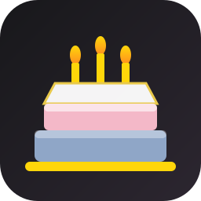
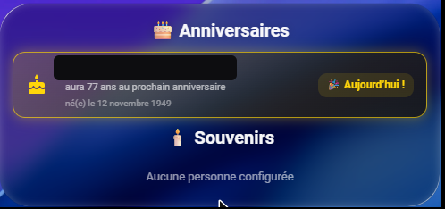
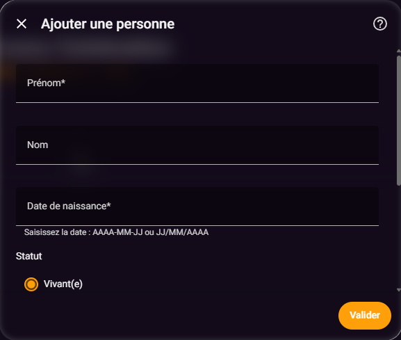

# 🎂 Anniversary Celebration

[](https://github.com/hacs/integration)
[](https://github.com/cyclope205/anniversary-celebration/releases)
[](https://github.com/cyclope205/anniversary-celebration/actions/workflows/validate.yml)
[](https://github.com/cyclope205/anniversary-celebration/actions/workflows/tests.yml)
[](https://github.com/cyclope205/anniversary-celebration/issues)
[](https://github.com/cyclope205/anniversary-celebration/blob/main/LICENSE)
[](https://github.com/cyclope205/anniversary-celebration/releases)
[](https://github.com/cyclope205/anniversary-celebration/releases/latest)
[](https://github.com/cyclope205/anniversary-celebration/stargazers)
[](https://github.com/cyclope205/anniversary-celebration/network/members)

---

### ❤️ Sponsors GitHub

<!--START_SECTION:github-sponsors-->
<!-- Aucun sponsor GitHub public actif pour le moment -->
<!--END_SECTION:github-sponsors-->

---
### ☕ Merci aux donateurs

<!--START_SECTION:paypal-->

<!--END_SECTION:paypal-->

<!--START_SECTION:buy-me-a-coffee-->
<!-- Les nouveaux dons seront ajoutés ici automatiquement -->
<!--END_SECTION:buy-me-a-coffee-->

---

[](https://bmc-eight-red.vercel.app/api/donate?repo=anniversary-celebration) [](https://bmc-eight-red.vercel.app/api/paypal?repo=anniversary-celebration&amount=5)


### ☕ Offrez-moi un café pour m'aider à rester éveillé et coder vos intégrations préférées !

En remerciement, votre nom apparaîtra (de façon anonymisée) dans la section « ☕ Merci aux donateurs » ci-dessus.

---

**Un anniversaire oublié, ça ne se rattrape pas.** Qu'il soit dans 3 jours ou dans 8 mois, Anniversary Celebration le sait et vous le rappellera — une seule fois, pile le bon jour, même si Home Assistant redémarre entre-temps. Pas de YAML à écrire, pas de capteur à bricoler : on renseigne un prénom et une date de naissance, et tout le reste — calcul d'âge, compte à rebours, notification, carte du tableau de bord — se construit tout seul. Et parce que certains anniversaires se fêtent autrement, les personnes qui ne sont plus là peuvent elles aussi avoir leur mot doux, chaque année, pour qu'on ne les oublie pas non plus.

Intégration Home Assistant qui suit les anniversaires des personnes vivantes et garde le souvenir des personnes décédées, avec une notification fiable le jour J et une carte Lovelace qui se construit toute seule.

## Sommaire

- [Fonctionnalités](#fonctionnalités)
- [Captures d'écran](#captures-decran)
- [Installation](#installation-hacs)
- [Configuration](#configuration)
- [Carte — configuration](#carte--configuration)
- [Fiabilité des notifications](#fiabilité-des-notifications)
- [Langues disponibles](#langues-disponibles)
- [Tests](#tests)
- [A savoir](#a-savoir)

## Fonctionnalités

- Ajout/modification/suppression des personnes via l'interface (Paramètres →
  Appareils et services → Anniversary Celebration → Configurer) : prénom, nom,
  date de naissance, statut (vivant / décédé), heure de notification
  (optionnelle), appareil/service à notifier (optionnel).
- Un capteur par personne (`sensor.<prénom>_<nom>`) : nombre de jours avant le
  prochain anniversaire, âge actuel, âge au prochain anniversaire, date de
  naissance, statut, et si la notification du jour a déjà été envoyée.
- Les personnes décédées peuvent aussi être notifiées (message « en
  mémoire » différent de celui des vivants).
- Carte `anniversary-celebration-card` : se construit automatiquement à
  partir des personnes configurées (pas besoin de toucher le YAML du
  dashboard à chaque ajout), triée par proximité, avec un 🔔 à côté du nom
  quand un appareil/service de rappel est configuré pour cette personne.
  Le nombre de personnes affichées est librement configurable
  (`max_items`), et un éditeur visuel permet de masquer ou afficher la
  section Souvenirs sans écrire de YAML.

## Captures d'écran

Carte Anniversaires / Souvenirs :



Formulaire d'ajout d'une personne (options de l'intégration) :



## Installation (HACS)

1. HACS → Intégrations → ⋮ → Dépôts personnalisés → ajouter ce dépôt
   (catégorie Intégration), ou rechercher **Anniversary Celebration**
   si le dépôt est déjà référencé.
2. Installer « Anniversary Celebration ».
3. Redémarrer Home Assistant.
4. Ajouter l'intégration : **Paramètres → Appareils et services →
   Ajouter une intégration → Anniversary Celebration**.
5. Configurer pour ajouter les premières personnes.

La carte Lovelace est enregistrée automatiquement par l'intégration : aucune
ressource à déclarer à la main.

## Configuration

Depuis les options de l'intégration (**Paramètres → Appareils et services →
Anniversary Celebration → Configurer**), un menu permet d'ajouter, modifier
ou supprimer une personne. Chaque personne possède :

| Champ | Obligatoire | Description |
|---|---|---|
| Prénom | Oui | Prénom affiché sur la carte et dans les notifications |
| Nom | Non | Nom de famille, optionnel |
| Date de naissance | Oui | Utilisée pour calculer l'âge et le compte à rebours |
| Statut | Oui | Vivant(e) ou Décédé(e) — change le message de notification |
| Heure de notification | Non | Heure à laquelle envoyer la notification le jour J (par défaut 00:00) |
| Appareil/service à notifier | Non | Service `notify.*` à appeler ; laissé vide, seule la notification persistante Home Assistant est créée |

## Carte — configuration

```yaml
type: custom:anniversary-celebration-card
title_alive: "🎂 Anniversaires"
title_deceased: "🕯️ Souvenirs"
show_deceased: true
max_items: 0   # 0 ou absent = toutes les personnes ; sinon nombre libre
```

## Fiabilité des notifications

Pas de minuteur unique programmé des mois à l'avance (qui se perdrait à un
redémarrage de Home Assistant, même si l'anniversaire est dans 8 mois).
L'intégration recalcule l'état de chaque personne **toutes les minutes** ;
dès que le jour J et l'heure configurée sont atteints, la notification part
une seule fois, mémorisée dans un stockage persistant (donc jamais répétée
ni jamais oubliée même après un redémarrage). Une notification persistante
Home Assistant est en plus toujours créée, même si l'appareil choisi est
indisponible ou si aucun appareil n'a été configuré.

## Langues disponibles

L'interface de configuration (ajout/modification/suppression d'une personne,
menus des options) est traduite en 22 langues parmi les plus utilisées par
Home Assistant : français, anglais, allemand, espagnol, italien, portugais
(Portugal et Brésil), néerlandais, polonais, russe, suédois, norvégien,
danois, finnois, tchèque, slovaque, hongrois, turc, grec, roumain,
ukrainien et catalan. Home Assistant choisit automatiquement la traduction
correspondant à la langue configurée dans votre profil utilisateur ; à
défaut de correspondance, l'anglais est utilisé.

## Tests

Le dépôt inclut une suite de tests automatisés (`tests/`, basée sur
`pytest`) couvrant notamment le calcul de date (jours restants, âge actuel,
âge au prochain anniversaire, cas du jour J et du 29 février) et la logique
anti-doublon/anti-oubli des notifications. Les tests sont exécutés
automatiquement sur chaque modification via GitHub Actions (badge « Tests »
ci-dessus).

## A savoir

- La vérification tourne toutes les minutes : une notification prévue à
  une heure donnée peut partir jusqu'à ~59 secondes après celle-ci, jamais
  avant.
- Le statut « Décédé(e) » n'empêche pas la notification : seul le message
  change (« en mémoire » au lieu de « joyeux anniversaire »).
- Les problèmes et demandes d'évolution se signalent via l'onglet
  **Issues** du dépôt.

## Licence

MIT — voir [LICENSE](https://github.com/cyclope205/anniversary-celebration/blob/main/LICENSE).
